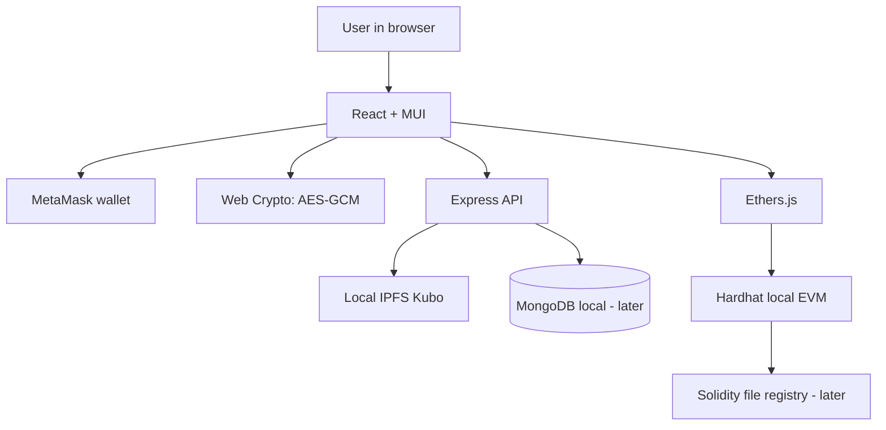

# System architecture — Milestone 3

## Data placement
- Browser: plaintext file transiently, AES key during encryption/decryption; future protected client key material.
- IPFS: encrypted file bytes only; CID identifies ciphertext.
- Blockchain: owner, CID reference, authorized wallet addresses and events (all public).
- MongoDB: non-secret indexes, encrypted per-recipient key envelopes; signed-wallet session checks required before delivery.

## Trust boundaries
- Wallet signature authenticates identity; it does not decrypt data.
- A blockchain access entry does not keep a public IPFS CID secret. Encryption protects content.
- Revocation does not undo past downloads. Re-key/re-encrypt future versions.
- Kubo RPC should bind to loopback; never expose it to the internet.
